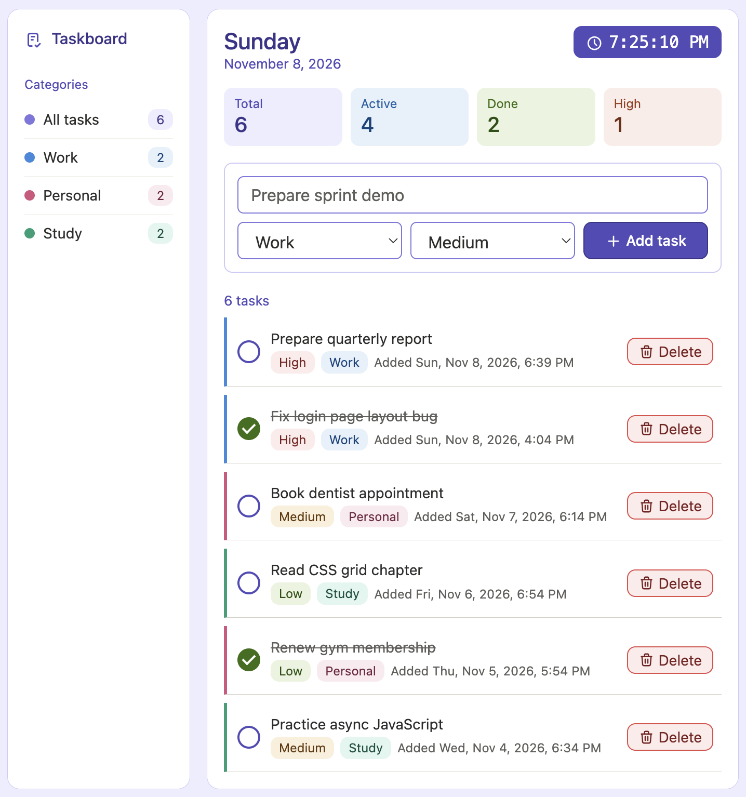

# TODO App Assessment

Build the task manager shown below using HTML, CSS, and JavaScript.

**Time limit:** xx hours

## Rules

- Use plain HTML, CSS, and JavaScript only.
- Do not use frameworks or UI libraries such as React, Bootstrap, or Tailwind.
- Icons may come from any icon library.

## Layout and styling

- Match the screenshot as closely as you can, including layout, spacing, and colors.
- Use semantic HTML and CSS variables for colors.
- Include hover and keyboard focus states for interactive elements.
- On screens 560px wide or smaller, stack the sidebar above the main content and show the summary cards in two columns.
- Long task names must wrap without breaking the layout.

## Saved data

- Tasks must remain after the page is refreshed.